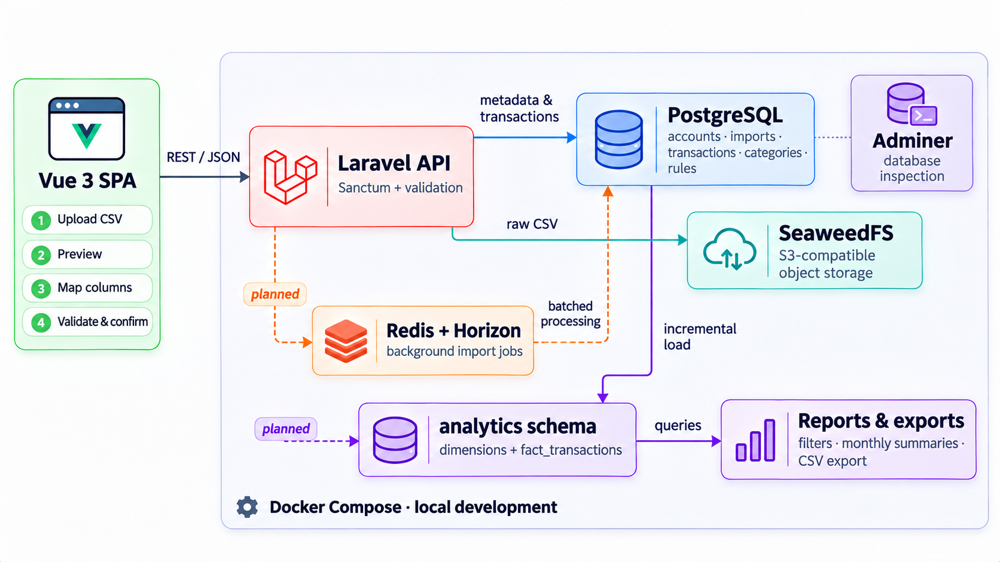

# Bank Statement Importer

Importer i kategoryzator wyciągów bankowych. Laravel 13 (API) + Vue 3 + Postgres.

## Architektura



## Jak uruchomić

```sh
docker compose up -d --build
```

| Usługa | Adres |
|---|---|
| Front | http://localhost:15173 |
| API | http://localhost:18000/api/health |
| Postgres | `localhost:15432`, baza `bank_importer`, użytkownik `bank`, hasło `secret` |

Gdy aplikacja działa na innej maszynie niż przeglądarka, ustaw w `.env` `PUBLIC_HOST` na adres tej maszyny (wzór: `.env.example`).

## Testy

```sh
docker compose exec api composer lint
docker compose exec api composer analyse
docker compose exec api php vendor/bin/pest
docker compose exec web npm run type-check
docker compose exec web npx vitest run
```

Automatyczna poprawa stylu (zapisuje zmiany w plikach):

```sh
docker compose exec api ./vendor/bin/pint
docker compose exec web npm run format
```

## Komendy
```sh
docker compose exec api php artisan make:migration create..
docker compose exec api php artisan make:controller BankAccountController --api
docker compose exec api php artisan make:request BankAccountRequest
docker compose exec api php artisan make:resource BankAccountResource
docker compose exec api php artisan make:policy BankAccountPolicy --model=BankAccount
```


